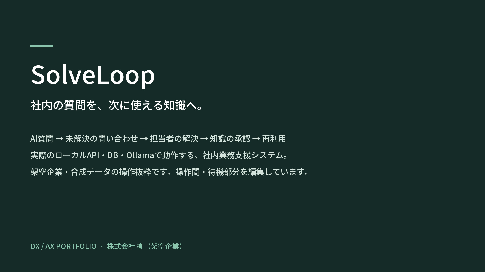
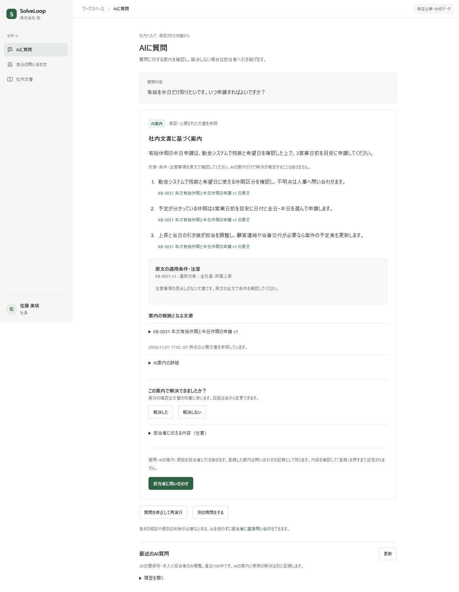
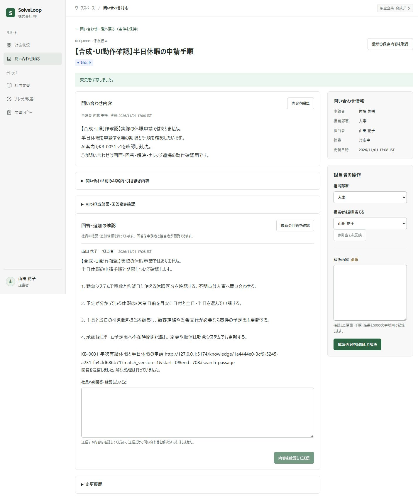

[日本語](README.md) · [한국어](README.ko.md) · [English](README.en.md)

# SolveLoop

*3:03 · Japanese subtitles · Select the image to open the video.*

**An internal support and knowledge system that puts resolved questions to use the next time someone asks.**

SolveLoop connects AI self-service guidance, ticket handling and knowledge capture to reduce employees' wait for answers and repetitive support work. It is a personal portfolio project set in the fictional company **株式会社 柳**. The UI and synthetic business data are in Japanese.

## Workflow

**Question → self-resolution feedback → unresolved-ticket handoff → operator resolution → knowledge draft → human approval → reuse**

Employees check guidance grounded in public documents and record whether it helped them resolve the issue. If not, they hand off the question, guidance and attempted steps to an operator. Document search and direct tickets are also available.

Operators review the context before replying. Resolution records become knowledge after human editing and approval, ready for later questions. **Knowledge Gap Radar** helps identify recurring tickets and documentation that needs work.

## Design decisions

- **Use approved knowledge only:** Saving, search preparation and publication approval are separate. Approval switches the public version and search target in one transaction.
- **Keep business records consistent:** The server checks permissions, ownership and versions. Concurrent edits return `409`; idempotency keys prevent duplicate creation. Business changes and history commit together.
- **Separate AI suggestions from human decisions:** Generating an answer is separate from resolution, and generating a draft is separate from approval. Radar also separates recurrence detection from coverage assessment. AI failures leave document search and operator handoff available.

## Stack

| Area | Technology |
| --- | --- |
| Frontend | React · TypeScript · Vite · React Router |
| Backend | Python · FastAPI · SQLAlchemy · Alembic |
| Database | PostgreSQL · pgvector |
| Local AI | Ollama · Qwen3 8B · **EmbeddingGemma2** |
| Execution and checks | Docker Compose · pytest · Node.js tests · GitHub Actions configuration |

AI execution lives in `backend/app/ai/`. Generation and embeddings use local Ollama, without an external AI API.

## Verification and current scope

The employee-question, operator-support, resolution, approval and retrieval workflow was checked with the real API, DB and Ollama. Checks also covered permissions, update conflicts and duplicate creation.

- This is a local project tested with synthetic data. Time savings in a real company have not been measured.
- AI interpretation of applicability/cautions and concurrent-request handling need improvement. Knowledge is published after human review and approval.

## Documentation

- [Run the project](docs/setup.en.md)
- [Evaluation summary](evaluations/README.en.md)
