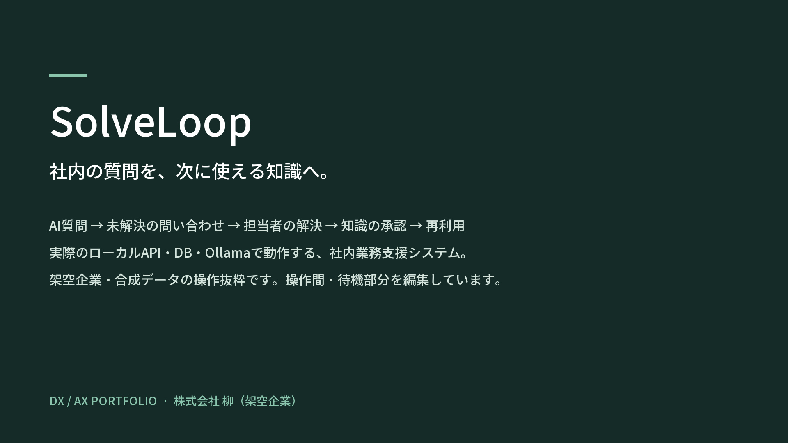
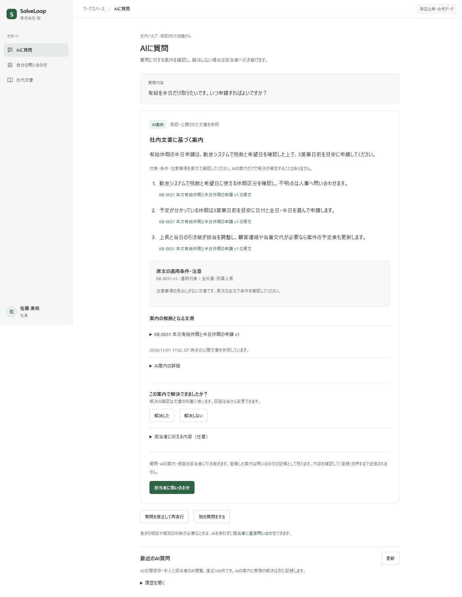
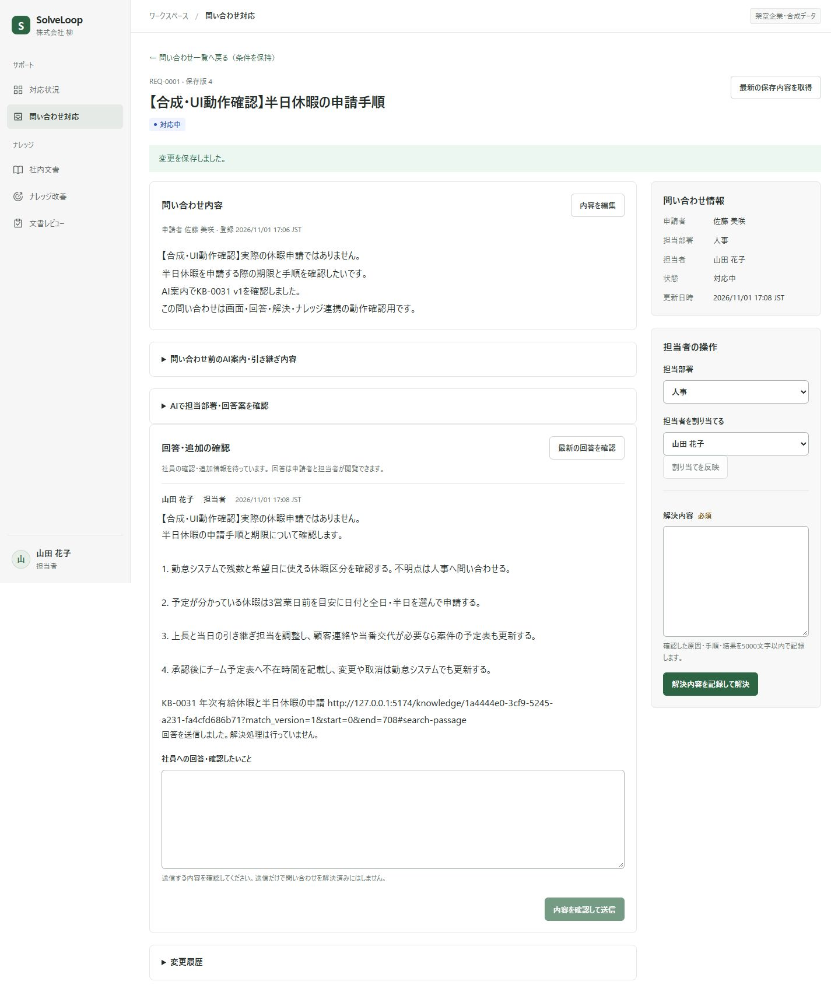

[日本語](README.md) · [한국어](README.ko.md) · [English](README.en.md)

# SolveLoop

*3분 3초 · 일본어 자막 · 이미지를 누르면 영상이 열립니다.*

**직원의 질문을 해결하고 해결 경험을 다음 질문에 활용하는 사내 문의·지식 관리 시스템**

직원의 답변 대기와 담당자의 반복 응대를 줄이기 위해 AI 자가 해결 안내부터 문의 처리·지식 축적까지 연결했습니다. 가상 기업 **株式会社 柳**를 배경으로 만든 개인 포트폴리오이며, 화면과 합성 업무 자료는 일본어입니다.

## 업무 흐름

**질문 → 자가 해결 확인 → 미해결 문의 인계 → 담당자 해결 → 지식 초안 → 사람의 승인 → 재사용**

직원은 공개 문서에 근거한 안내를 확인하고 해결 여부를 기록합니다. 해결하지 못했다면 질문·안내·시도한 내용을 담당자에게 전달합니다. 문서 검색과 직접 문의도 가능합니다.

담당자는 앞선 맥락을 확인하고 응대합니다. 해결 기록은 사람이 편집·승인한 지식으로 남겨 다음 질문에 활용합니다. **Knowledge Gap Radar**는 반복 문의와 문서 보완 대상을 찾는 데 사용합니다.

## 설계에서 중점을 둔 부분

- **승인한 지식만 제공:** 저장·검색 준비·공개 승인을 분리하고, 승인 시 공개 버전과 검색 대상을 같은 트랜잭션에서 전환합니다.
- **업무 기록의 정합성:** 서버에서 권한·소유자·버전을 검사합니다. 동시 수정은 `409`로 처리하고, 멱등성 키로 중복 등록을 막으며 업무 변경과 이력을 함께 저장합니다.
- **AI 제안과 사람의 판단 분리:** 답변 생성과 실제 해결, 초안 생성과 공개 승인을 구분합니다. Radar의 반복 탐지와 문서 대응 판정도 별도로 다룹니다. AI 실패 시 문서 검색과 담당자 문의로 이어갈 수 있습니다.

## 기술 구성

| 영역 | 기술 |
| --- | --- |
| 프론트엔드 | React · TypeScript · Vite · React Router |
| 백엔드 | Python · FastAPI · SQLAlchemy · Alembic |
| 데이터베이스 | PostgreSQL · pgvector |
| 로컬 AI | Ollama · Qwen3 8B · **EmbeddingGemma2** |
| 실행·검증 | Docker Compose · pytest · Node.js 테스트 · GitHub Actions 설정 |

AI 실행 코드는 `backend/app/ai/`에 통합했습니다. 생성·임베딩은 로컬 Ollama를 사용하며 외부 AI API에 의존하지 않습니다.

## 검증과 현재 범위

직원 질문부터 담당자 응대·해결, 지식 승인과 재검색까지 실제 API·DB·Ollama를 연결해 확인했습니다. 권한·수정 충돌·중복 등록도 검증했습니다.

- 합성 데이터로 검증한 로컬 프로젝트입니다. 실제 기업의 업무 시간 절감 효과는 측정하지 않았습니다.
- AI의 적용 조건·주의사항 해석과 동시 요청 처리에는 개선이 필요합니다. 지식은 사람이 검토·승인한 뒤 공개합니다.

## 문서

- [실행 방법](docs/setup.ko.md)
- [평가 요약](evaluations/README.ko.md)
