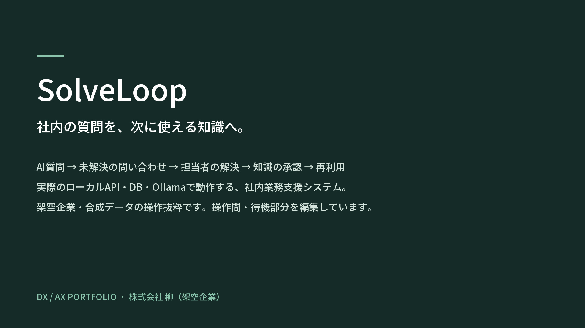
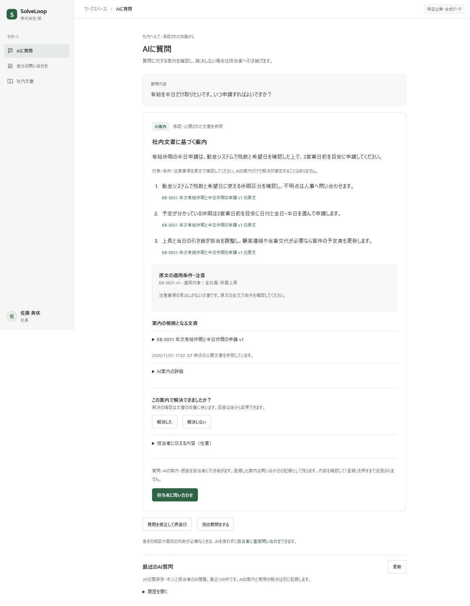
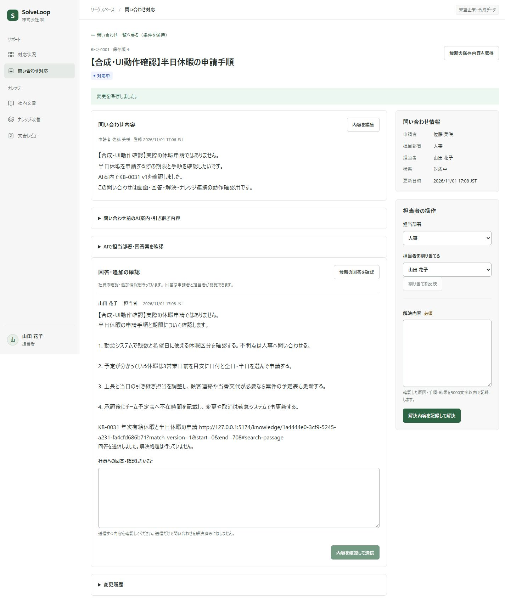

[日本語](README.md) · [한국어](README.ko.md) · [English](README.en.md)

# SolveLoop

*3分3秒 · 日本語字幕 · 画像をクリックして動画を開く*

**社員の疑問を解決し、その経験を次の問い合わせに生かす社内サポート・ナレッジ管理システム**

回答待ちと担当者の繰り返し応対を減らすことを目指し、AIによる自己解決の案内から問い合わせ対応・知識の蓄積までをつなぎました。架空企業 **株式会社 柳** を題材にした個人ポートフォリオで、画面と合成の業務資料は日本語です。

## 業務の流れ

**質問 → 自己解決の確認 → 未解決の引き継ぎ → 担当者の解決 → 知識の下書き → 人の承認 → 再利用**

社員は公開文書に基づく案内を確認し、解決したかを記録します。解決しなければ、質問・案内・試したことを担当者へ引き継ぎます。文書検索と直接問い合わせも利用できます。

担当者はそれまでの経緯を確認して応対します。解決記録は人が編集・承認した知識として残し、次の質問に活用します。**Knowledge Gap Radar**では繰り返し問い合わせと文書の補完対象を探します。

## 設計で重視したこと

- **承認した知識だけを提供：** 保存・検索準備・公開承認を分け、承認時に公開版と検索対象を同じトランザクションで切り替えます。
- **業務記録の整合性：** サーバーで権限・所有者・版を検査します。同時編集は `409`、重複登録は冪等性キーで扱い、業務変更と履歴を一括保存します。
- **AIの提案と人の判断を分ける：** 回答生成と実際の解決、下書き生成と公開承認を区別します。Radarの反復検出と文書対応判定も別に行います。AIが失敗しても、文書検索・担当者への問い合わせへ進めます。

## 技術構成

| 領域 | 技術 |
| --- | --- |
| フロントエンド | React · TypeScript · Vite · React Router |
| バックエンド | Python · FastAPI · SQLAlchemy · Alembic |
| データベース | PostgreSQL · pgvector |
| ローカルAI | Ollama · Qwen3 8B · **EmbeddingGemma2** |
| 実行・検証 | Docker Compose · pytest · Node.jsテスト · GitHub Actions設定 |

AI実行コードは `backend/app/ai/` に統合しました。生成・埋め込みはローカルOllamaを使い、外部AI APIには依存しません。

## 検証と現在の範囲

社員の質問から担当者の応対・解決、知識の承認・再検索まで、実API・DB・Ollamaで確認しました。権限・更新競合・重複登録も検査しています。

- 合成データで検証したローカルプロジェクトです。実企業での業務時間の削減効果は測定していません。
- AIによる適用条件・注意事項の解釈と同時要求の処理には改善が必要です。知識は人が確認・承認してから公開します。

## ドキュメント

- [実行方法](docs/setup.md)
- [評価要約](evaluations/README.md)
